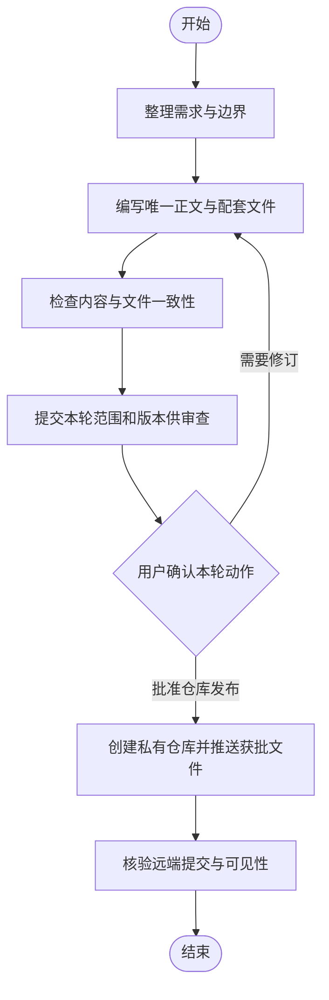

# PROJECT_SPEC：rules-repository

- 实施版本：1.0.0-draft
- 状态：initial-review
- 通用正文：general-collaboration-protocol 1.0.0，尚未批准生效

## 目标与边界

准备一个可审查、可提交的纯文档和结构化配置仓库。拟使用 GitHub 私有仓库 karlsen-ai-collaboration-rules，主干按项目目录组织；不采用长期项目分支，不放业务代码，不创建嵌套仓库。新增模型复用唯一正文。

第一版包括正文、元数据、入口、模板、发布约定与验收清单。不部署自动同步，不安装工具，不添加执行钩子、CI 权限或外部服务凭据。个人对话、私人任务上下文、实际审批内容、上传原图和同事私人数据均不纳入。

本地准备、创建外部仓库、推送、改变可见性和正式批准规则是不同动作，须分别核实其适用授权；本项目文件不替代实际授权。

## 输入、输出及验收

输入为用户已确认的协作规则需求；输出为本仓库文件。检查相对链接、JSON、正文哈希、规则编号、Mermaid 围栏、目录范围及敏感文件排除。GitHub 发布后另验私有可见性、精确提交和远端内容；未执行就保持待验证。

## 主业务流程

本轮范围：仓库 1.0.0 initial-review 文档包；规则本身尚未 approved。菜单是交互模板，不表示当前用户已经批准图中任何动作：
1. 确认执行：仅限本轮列出的动作、产物和版本。
2. 重新检查：修订当前方案。
3. 确认流程：核对主业务流程，不批准执行。

## 恢复与后续

中断后先核实本地文件和外部仓库是否已创建、提交是否已到达远端，避免重复创建或推送。连接或授权不足时报告准确阻塞。正式生效另按发布约定取得对确切正文的批准；接入自动化另行设计、授权和实测。
