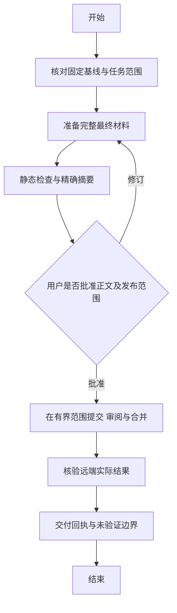

# PROJECT_SPEC：rules-repository

## 目标与稳定边界

维护 Karlsen9527/karlsen-ai-collaboration-rules 公开规范仓库，保留唯一 core、独立标准和薄入口。主干按项目目录组织，不以长期项目分支作权限隔离；不放业务代码、嵌套仓库、私人任务或审批原文。

本实施说明不是产品版本，也不持有本次任务状态或批准。当前目标、执行状态、实际工作基线和唯一状态写入责任方由获准任务上下文登记引用；不为本次发布新建状态总账。正文发布、项目采用与运行接入各有独立授权。

## 版本与来源权威

- core：标识 general-collaboration-protocol，版本唯一来源 [core/PROTOCOL.md](../../core/PROTOCOL.md)，本快照为 8.0.0；状态与材料查同一固定提交的根清单及可信批准。候选不构成生效，旧批准不自动撤销。当前 core 仅约束用户与主助手，执行者默认按完整任务路线和项目约束执行，不加载 core 或聊天菜单。历史 core 2.0.0 与完整原发布材料固定查 07fffb46a1946392d63614dd82e698cef8f0cec0；工程 1.1.0 的 core 依赖仍使用该固定来源，不随当前 core 更新。
- 工程：标识 agent-engineering-collaboration，版本唯一来源 [工程正文](../../standards/AGENT_COLLABORATION.md)，状态查[独立清单](../../standards/releases/agent-collaboration/1.1.0/manifest.json)；仅任务明确采用时适用。
- 目录：标识 project-structure-and-versioning，固定 1.0.0 基线 7208cef99ea7783a5b574b5f6829889795e1c03e，路径 standards/PROJECT_STRUCTURE.md，SHA-256 01ec4306eb4b37468ad63e518a9c9a129ade863acfe4fc7538c51c7bd2961177；原清单和标签保留。
- 历史 core 1.0.0：固定 7115cc9e8c262f6d07c7f89558c1f477593bf8e5，路径 core/PROTOCOL.md，SHA-256 284cae9edb5f41ef88d26dc7ce19e4cf8ab167468e3de0adf04d53879209d8c0；正文与根清单都按该提交读取。

本仓库发布任务在其获准外置上下文中固定适用治理基线、范围及例外，不能用正在申请批准的新正文自我批准发布。此文件不预填包含自身的未来提交。依赖读取与当前/历史契约见[发布约定](../../releases/README.md)。

## 输入 输出与验收

输入为已确认的规则需求、固定仓库基线和精确审阅材料；输出仅为本任务批准的文档和结构化清单路径。版本、原始字节、链接、JSON、规则编号、场景来源、目录边界和敏感内容依 [ACCEPTANCE.md](../../ACCEPTANCE.md) 检查。共享仓库只保存适合共享的审批引用，真实身份与批准证据保留在可信授权渠道。

发布前必须解决已知工具能力门槛；发布后独立核对公开可见性与获准发布范围、远端提交、原始字节、本次对应清单及其约定定位。本次 core 8.0.0 不新增标签，以固定发布提交、根清单、正文哈希与可信批准回执定位；历史版本仍按其原标签契约核验。源码提交、PR ready、哈希相同和仓库 approved 文案均不代替用户授权。

## 主业务流程

图不授予动作权限，异常处理、对应版本的 C/P/R 或 C/D/R 顺序与后生字段契约见发布约定。需用户决策时由主助手集中说明选项，执行者不承担聊天菜单；不在本稳定文档中预填本轮批准。

## 恢复与后续

中断后先读取分支、commit、PR、标签和已完成事实，避免重复创建。main、head、文件字节、接收方或权限实质变化时暂停相关动作；安全且无依赖的只读核验可继续。不强推、不重写旧标签，不靠重新运行证明历史通过。自动加载、配置安装、工作流、GitHub Release、业务项目采纳及产品部署不随规范发布自动发生。
