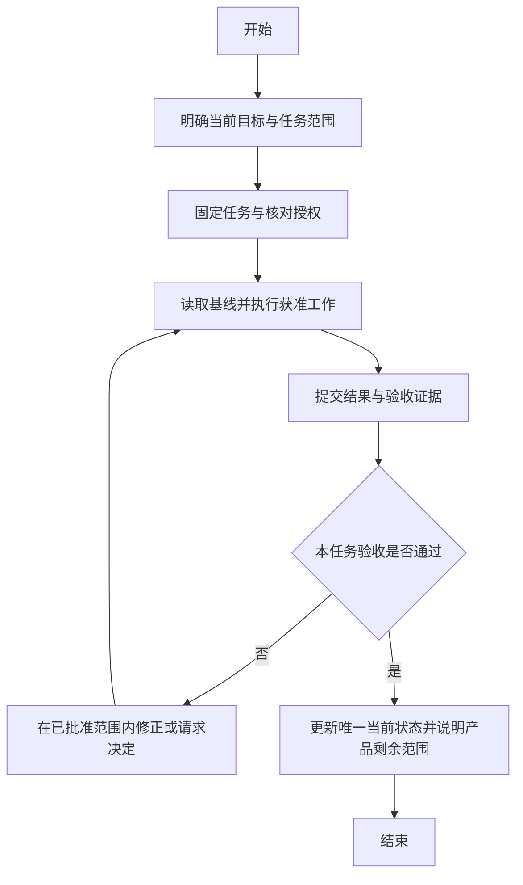

# 多角色工程协作规范

- standard_id: agent-engineering-collaboration
- version: 1.0.0
- 正文位置：standards/AGENT_COLLABORATION.md
- 关联通用规范：general-collaboration-protocol 2.0.0，读取同一固定发布快照的 core 与根清单
- 目录基线：project-structure-and-versioning 1.0.0，固定来源见本标准清单
- 发布与生效状态以[独立清单](releases/agent-collaboration/1.0.0/manifest.json)及可核对的可信批准为准；版本文字不构成批准。
- 标签名：agent-collaboration-v1.0.0；名称本身不证明标签已创建。

本规范不启动调度器、不改变现有项目 pin，也不授权仓库或配置写入。正式发布后仍须项目明确采用，才能成为该项目的适用要求。发布契约见[发布约定](../releases/README.md)。

## 一 目的与适用边界

本规范用于人与多个模型、执行器、同事之间的工程交接，保证任务边界、授权、实际源码、证据和完成结论可以对应。单人任务可合并角色，但不能省略必要授权或把自报当作独立复核。

通用对话方式继续由 core 管理；目录、版本和发布基础约定继续由 PROJECT_STRUCTURE 管理。本文件补足工程协作的执行契约，不复制这两份规范，不修改历史发布内容。若约束冲突，适用第六节停手全集中的 S02；不能私下选较宽松的一条。

按风险与实际依赖使用本规范。短小只读任务可用精简上下文；无关字段注明不适用及原因，不为填满模板新增系统或文件。已核验且未变的固定内容可复用可信缓存，必要发布状态与权限检查仍保留；不要求每轮重复下载、重复哈希或重新审查整份产品。

本规范不授权创建仓库、上传源码、安装软件、改权限、调用新的外部服务、发通知、创建自动化、合并或部署。批准采用规范、批准某项任务、批准实际动作是不同事项，可在明确范围内一并确认，不能互相替代。

## 二 角色与责任可以按项目配置

每项任务明确以下职责的实际承担者，可以是人、工具或模型，允许一人承担多项，但须显式登记：

| 职责 | 责任 | 不自动拥有的权力 |
| --- | --- | --- |
| 目标负责人 | 设定当前目标、验收目标和优先级 | 不因头衔获得工具权限 |
| 任务分配方 | 根据获准范围形成不可变任务、分配执行者 | 不能自填批准替用户授权 |
| 执行方 | 核对任务并实施获准动作，提交实际结果 | 不能扩大任务或代替复核结论 |
| 复核方 | 按固定基线检查差异、测试和证据，注明独立核验范围 | 复核通过不自动批准合并或发布 |
| 合并或发布责任方 | 在获准范围执行合并、发布并核实远端状态 | 不能以 PR ready 或绿色检查替代授权 |
| 状态维护方 | 单独维护当前目标与运行状态权威记录 | 不能据此改变任务审批或重写他人报告 |

任务分配方可以是上游协调者、项目负责人或获准同事，不强制所有项目使用“主代理发单”的固定组织结构。可选安排示例：谢多多负责协调与复核，Codex 与 dsh 分担执行；它只演示角色映射，不授予任何主体权限，也不要求其他项目照搬。

真实报告保留实际作者、工具或执行来源；同账号提交、Git author 字段、事件 sender、PR 发起者或仓库内签名文本，均不足以单独证明某自然人的授权。需要授权时，必须关联能在可信渠道核对的批准；共享报告只放适合共享的引用，不放私人批准原文和身份资料。

若要求独立复核，应由未产出被审内容的人员或独立运行执行，并准确报告独立性限制。自查可以有用，但须写“执行方自查”，不能改名为独立验收。

## 三 当前状态使用单一权威来源

### 3.1 一个目标的一份当前状态

项目选择已有合适位置，或经项目批准新增一处当前状态记录。例如 docs/CURRENT_GOAL.md。路径只作示例，不强制新建，也不强制搬迁现有内容。它至少包括：

- 项目标识、goal_id、当前阶段与目标；
- 已完成、进行中、待验证、阻塞或等待批准的事项；
- 对应 task_id / revision / run_id 及其可取回引用；
- 最近一次有意义的更新时点、唯一写入责任方；
- 下一项允许动作、验收结果和产品剩余范围；
- 相关批准引用与限制。引用是索引，实际授权仍单独核对。

README、AGENTS、PROJECT_SPEC 和其他入口只引用这一位置，并保留各自稳定职责。任务快照负责“本次究竟做什么”，报告负责“实际发生什么”，发布记录负责“哪个版本已发布”，不能让当前目标文件同时冒充这些证据。

不要求每次运行改写六份或其他固定数量的文档。只有稳定入口、接口或约束真的变化时，才在获准范围更新对应文档。运行状态变化只写其权威位置；没有新信息不产生重复报告。

### 3.2 单写与并发

状态记录由指定责任方更新，其他角色提交独立结果或建议。可以从各角色不可变记录生成只读汇总，但汇总必须标注其派生性质和时点，不构成另一个可写总账，也不授予任务权限。

更新前核对已读版本与当前版本；工具支持 expected-head、expected-version 等原子条件写入时，使用已核对值作为写入条件；缺少该能力且存在实质并发风险时暂停受影响写入，不新增锁服务。发现用户或其他进程已改动相关文件，触发 S05。先保留现状，核对作者或来源、时间、差异、相关进程以及影响范围，不能先覆盖再解释。仅无关文件变化且确认与本次动作、共享资源无依赖时，才继续独立工作。

## 四 任务快照和有界批准

### 4.1 派发前需要完整而不重复的契约

使用本包 TASK_CONTEXT 模板，至少明确：目标、非目标、模式、方案编号、角色、输入、输出、允许与禁止动作、文件范围、工作环境、task revision、实际工作基线、验收标准、完整停手条件、报告路径和后续责任。

任务引用必须能够取回精确内容。已入 Git 的输入用仓库、commit、相对路径；未入 Git 的输入用已获准且可访问的快照及原始字节哈希。单独一个哈希或“看最新版”不够。不存在 Git 源码基线时，明确写非 Git，不能顺带初始化或上传。

任务正文先冻结，再计算原始字节哈希并取得精确批准。实际任务哈希、批准状态与证据，以及提交生成后的 task_commit，写在独立的获准派发/批准记录；任务正文只预先引用该记录位置，不为补这些后生字段改写已冻结正文。外置记录的任务哈希只覆盖任务正文，不覆盖记录自身，也不预填包含记录自身的未来 commit。

task_commit 定位任务正文；work_base 定位实际执行输入；current_goal 定位当前目标状态；result_commit 定位交付结果。四者不能互相顶替。存在会影响执行的未提交修改、未跟踪文件或外部输入时，必须纳入获准、可复核的基线说明；不能用裸 commit 隐藏额外输入。

### 4.2 批准后不可覆盖

批准绑定 task_id、revision、精确内容、动作范围、产物和验收。可以一次批准有界流程，例如“限定文件的实现、已列测试、最多两次同范围修复、提交到指定分支并创建草稿 PR”；具体上限由项目与用户决定，不由本规范替用户授权。

原 revision 只读保留。新增功能、替换验收、扩大路径、改变目标、提高风险、换权限或换外部接收方等实质变更，形成新 revision，列明差异并取得需要的批准。执行方不得修改原任务来追认已经发生的动作。

纯状态更新和不改变要求的说明修正，放在后续记录，不覆盖已批准任务。是否实质变化有疑问时按 S01/S02 处理。

### 4.3 派发摘要不是另一份任务

派发消息可以简短，但必须提供精确任务定位、工作基线、最关键限制、交付位置及完整停手条件引用，并注明“以下停手摘要非穷尽，以固定任务引用的全集为准”。不在多处维护不同版本的停手清单。

接单时先读完整任务、适用规范与必要输入，核验授权与基线，再操作。引用读不到、版本不符或关键字段缺失，按第六节暂停受影响步骤，不猜测缺失内容。

## 五 原始字节 基线和证据

### 5.1 正确核验内容哈希

期望值来自已固定且可信的任务、批准材料或发布记录；实测值由实际获取的原始字节机器计算。分别记录 expected_sha256、computed_sha256、算法、输入路径或来源 commit、字节数、核验时间和匹配结论。

校验前不得先规范化换行、重新编码、截断文本或重新序列化 JSON，再把结果称为原文件哈希。文本 API 如会转换内容，应改取 base64 或获准的原始文件；无法取得原始字节时标记“未完成原始字节核验”，不假装通过。哈希一致证明内容一致，不证明身份、权限、测试完成或历史行为。

多个文件逐项定义校验范围。包摘要需规定排序、路径编码和组合算法，不能把一个文件的哈希说成整个包的哈希。没有包摘要需求时逐文件即可，不新建复杂签名系统。

### 5.2 不制造自引用

文件不写入自己的最终内容哈希。包含报告的提交尚未生成时，报告内 result_commit 写“提交后由交付回执登记”，不预填未来 commit。

形成提交后，另行读取实际提交、远端 PR head、检查结果及文件清单，通过后续回执或 PR 链接登记；回执自身同样不要求预填包含自己的未来 commit。正文哈希、文件集合哈希与 commit SHA 是不同对象，分别标识。

本规范不自动授予提交、推送、修改 PR 或写回执的权限；未获准时只准备本地交付，报告缺少哪个外部验证环节。

### 5.3 历史证据缺失

过去的执行、日志和审批缺失时，写明具体事件的历史状态 UNVERIFIED，以及现有证据覆盖的范围。禁止重新构造已删除的私人日志，禁止用今天重新运行的结果证明过去通过，禁止倒填时间、补造截图或伪造批准。

若任务允许当前复测，可以报告“当前基线复测通过；历史运行仍未核实”，二者并列。需要历史证据才能执行的后续动作按 S07；不依赖该历史的独立工作可以继续。

### 5.4 报告修正

只在获准写入位置追加精简修正记录，关联原 task_id、revision、run_id 和原报告路径，包含：原说法、修正后事实、原因、新证据或仍缺失的证据、影响。旧报告与其证据保留。

修正文案不产生新 run_id。真正再次执行才分配新 run_id，并遵守该任务的重试边界。代理上传者不得改变执行者结论；共享证据应事先筛选到获准范围，不通过覆盖已固化证据来“清理”。

## 六 唯一完整停手条件

本节 S01–S12 是本标准唯一维护的停手全集。固定任务引用本节的精确标准快照；项目确有额外条件时，把额外条件完整列入该任务的 project_stop_conditions。二者合成该任务唯一的 stop_conditions；派发摘要、流程图和报告不维护新的竞争版本。

“停手”指立即停止会受影响的写入、提交、上传、执行或后续承诺。已授权、无依赖且安全的只读核对与独立工作可继续。发现危险且正在执行时优先安全停止，不为了补文档扩大损害。下面每一项都须记录触发事实、影响范围、已完成状态和恢复依据。

| 编号 | 触发条件 | 恢复条件或终止结论 |
| --- | --- | --- |
| S01 | 缺少具体动作的有效授权；批准身份、对象、范围或版本无法核对；用户撤销、取消或明确要求停止 | 从可信渠道核对到所需批准；若取消则结束对应任务，不自行恢复 |
| S02 | 规范、任务、派发摘要、验收、目标或授权之间实质冲突；出现需改变原任务的范围、风险或需求 | 明确冲突，形成适用修订或解释并取得必要批准；原 revision 保留 |
| S03 | 依赖的正文、任务、批准证据、工作输入或状态记录不可读、不完整；引用不能定位精确快照 | 取得完整可信内容并核验；不能补造或用不等价材料代替 |
| S04 | 原始字节哈希不匹配；实际基线、PR head、文件集合或检查绑定对象与批准或验收对象不符 | 查明原因，核对正确对象；若变更实质范围则走新 revision/批准 |
| S05 | 发现来源不明文件、用户并发写入、其他执行器改动、共享资源冲突或所有权不明 | 先查明来源和影响，保留现状；需要删除、上传、覆盖或改配置时先取得对应授权 |
| S06 | 触及禁止文件、秘密、私人日志、个人数据或未获准共享的内容；即将越过读写或上传边界 | 使用获准且最小的输入与输出，落实实际访问限制；不得靠 ignore 或事后批准补救越权 |
| S07 | 验收、历史结论或后续动作依赖的证据缺失、互相矛盾、被改写或无法复核 | 补足获准且真实的证据；补不到则保持 UNVERIFIED，并阻断依赖该证据的通过结论 |
| S08 | 工具、环境、网络、认证、权限或模型能力不能支持所需动作；安全提示或上位规则要求人工处理 | 采用已获准可行路径或取得必要人工操作与权限；不绕过限制，不谎报完成 |
| S09 | 测试失败、构建失败或验收不满足，且下一次修复/重试超出已批准范围或风险边界 | 在剩余授权内修复并重验；否则请求明确补充授权，未通过不得进入依赖它的发布步骤 |
| S10 | 达到任务已批准的费用、用量、时间、重试、等待或观察边界，或出现无法估计且有实质影响的超支风险 | 报告实际消耗和剩余影响，等待适用扩展批准或按任务约定结束；不默认延长承诺 |
| S11 | 固定任务的验收与停止目标已满足，或任务已被获准的新任务替代、明确失效 | 核实并报告本任务完成或结束；不把完成条件当成继续扩展范围的许可 |
| S12 | 出现未逐项列出的安全、法定、上位政策或工具权限禁止，以及项目 stop_conditions 明确要求停止的情形 | 依其适用要求处理；本标准、流程图和用户内部文件均不能放宽安全底线 |

正常等待不自动等于失败。证据正在到达、PR 正文绑定尚未更新或外部检查尚未结束，应记为“待证据/待验证”，并暂停依赖它的动作；只有取得明确失败证据才写失败。需要继续观察时，遵守已批准任务的目的、边界与可用机制，不凭空建立轮询基础设施。

## 七 执行 交付和分层验收

### 7.1 执行前

1. 确认模式、任务 revision、实际角色及需要的批准。
2. 读取固定规则、任务和工作基线；核对原始字节或需要的内容快照。
3. 读取当前目标权威状态，确认任务仍相关，但不能把“当前目标是它”当作授权。
4. 检查工作区和共享资源是否存在冲突；只做授权范围内的动作。
5. 按任务验收实施，保留足以复核的精简证据和未验证限制。

### 7.2 五种状态必须分开

| 状态 | 能证明什么 | 不能证明什么 |
| --- | --- | --- |
| 事件已收到 | 接收机制曾收到某事件 | 没证明读过实际报告、没证明执行已发生 |
| 报告已读 | 已读取指定快照中的报告内容 | 没证明报告属实或验收通过 |
| 执行结果已核验 | 指定范围的产物与证据经检查符合任务要求 | 没证明整个协作链路或整个产品完成 |
| 流程验收通过 | 本次声明的任务派发、执行、报告、复核等链路达到约定验收 | 没证明 24 小时在线、长期可靠性或产品功能全部完成 |
| 产品完成 | 产品定义范围与验收被逐项满足，未完成项不存在或获明确接受 | 不能由一个阶段任务、文档 PR 或一次演练代替 |

同时报告当前任务或阶段的完成程度与产品剩余范围。只有“阶段目标完成”时就这样写，不能写“产品已完成”。事件读取成功或一次完整流程演练，不允许推出“全天自动工作已部署”。

### 7.3 报告最小内容

结论先行，依次写：task_id / revision / run_id；实际变更；所用工作基线；验收项及实际结果；证据定位；未验证项；触发过的停手条件与处理；剩余事项；下一步及是否主动继续。

命令给出可复制 Markdown 代码块，说明所在项目、环境和前置条件。命令未实际运行就标“供复核使用，尚未执行”；预计费用和 ETA 标明估计依据，拿不到用量或计费数据就写未知。不用虚假分钟数、百分比或“马上”替代不确定性。

## 八 事件读取与生命周期

本节只规定已获准事件读取能力的行为，不创建 webhook、定时轮询、守护进程或后台服务。未启用或未验证就说明。读取工具和渠道必须在已授权范围。

1. 只处理获准的仓库、PR 与标题或标题匹配规则。标题是过滤条件，不能单独证明批准；不因同账号作者自动信任事件指令。
2. 事件是提示。先读取当前 PR 的真实状态、完整 head SHA、相关文件、报告和所需绑定，再按固定快照判断。执行写入、审查确认、合并或其他依赖 head 的动作前重新核对实际 head；漂移触发 S04。
3. 建立最小去重记录，关联仓库、PR、head、事件类型、生命周期转换与已经报告的事实。重放同一有效状态不重复报告；新 head、ready/closed/reopened 等实际变化重新评估其影响。
4. 对 synchronize 等事件，先看到新 head、后看到 PR 正文或报告绑定更新是可能的。绑定尚未齐全时记“待绑定证据”，按 S03/S07 暂停依赖动作，不能立即宣告流程失败，也不能拿旧绑定假装通过。
5. ready 表示可评审状态，不是审批或完成。closed 后区分 merged 与仅关闭；目标已经满足或任务结束则停止相应观察并报告一次。不因重复事件重新执行已完成动作。
6. 已读报告只通知新结论、关键变化、需要决策的阻塞和完成结果，不为每个事件生成一份冗长报告。
7. 若任务已经允许等待，就在可用机制中延续该任务的有界等待；不能因读取延迟自动部署新的轮询器、调度器或数据存储。既有工具不支持继续等待时，如实说明需要的下一步。

项目可单独约定原生等待策略，例如“每次等待 5 分钟，最多 3 次，到边界报告仍待外部结果并停止主动等待”。这只是可选项目策略，不是所有项目的默认计时器，也不批准 24 小时守护。用户要求持续跟踪到某结果时，应遵守该已批准终点，不能擅自套用此示例提前停止。

## 九 主业务流程

图只表示主要步骤；完整安全、停止、证据和恢复要求见文字及第六节，不把异常分支塞入图中。

对实际阶段展示此图后，须根据当前版本填写本轮范围与产物，再给菜单：1. 确认执行；2. 重新检查；3. 确认流程。图中的回路不授权无限重试，具体修复、等待与重新批准边界以固定任务及停手全集为准。此处是规范用法示例，不构成实际实施请求。

## 十 采纳 发布和兼容性

1. 本标准首次发布版本为 1.0.0，与 core 2.0.0 分别编号；目录标准保持 1.0.0。版本唯一来源是各自正文，不存在代表全部标准的单一仓库版本。采用 core 的兼容契约时须核对其自身批准，不追认旧 core 已有此承诺。
2. core 与本独立标准分别有精确正文及哈希，Codex 附属材料与任务模板逐项列入材料清单。一次审阅可以批准整个明确发布集合；批准必须覆盖精确内容及具体发布动作，不能由本规范自行授予。
3. 正式发布前固定版本和所有非清单文件原始字节，再机器计算摘要并取得最终材料批准。之后正文、模板和稳定说明均不得改字节；只有清单中事先批准的后生审批字段允许转换。
4. 本标准唯一清单为 standards/releases/agent-collaboration/1.0.0/manifest.json，目标标签为 agent-collaboration-v1.0.0。候选清单保持 initial-review、effective=false、approval=null；可信批准及真实候选提交形成后才按发布约定转换。清单不含自身最终哈希或包含自身的未来 commit。
5. 同批 core 2.0.0 使用根 releases/manifest.json，目标标签 core-v2.0.0。旧 core 1.0.0 的正文与根清单通过 7115cc9e8c262f6d07c7f89558c1f477593bf8e5 固定读取；目录标准 1.0.0 通过 7208cef99ea7783a5b574b5f6829889795e1c03e 和原标签固定读取。保留历史字节、批准记录及标签，不把当前 main 同名文件当作旧版，也不自动撤销旧版批准。
6. 发布后实际核对目标文件字节、清单、标签、commit 和批准引用。任何 approved、effective、标签或哈希都不能自我授权；正文冻结与 C/P/R 提交顺序以发布约定为准。
7. 业务项目是否采用新规范、更新固定 pin 或迁移状态记录，由该项目另行批准。发布通用规范不自动改变业务项目、原 R5 方案、旧入口、模型配置或调度服务。
8. 按项目最小采纳：先列差异与例外，再做获准补齐；稳定入口只加引用，已有有效目录保留。没有实际用途不创建空目录。

## 十一 验收检查

正式审阅或试点至少逐项验证 [规范验收场景 A01–A16](../templates/MINIMAL_EXAMPLES.md#规范验收场景)；该节为唯一维护来源，审阅差异中的展示由它同源生成。这是本次规范设计的验收集合，不是每项日常任务都要重新跑的全量测试；日常只检查任务相关的风险与依赖，按需要复用有效证据。用事实填写通过、失败或未验证，不因规范文本包含要求就声称运行实现已达标。

- 每个任务只有一个完整停手条件引用，派发摘要可追溯。
- 当前状态单写且入口只引用，角色、任务、证据与权限没有混为一谈。
- 原始字节 expected/computed 可复算，任务、源码与报告基线分开，无自哈希或未来 commit 循环。
- 未知文件、并发写入、历史缺失、报告修正均有明确可执行处理。
- 事件接收、读取、执行验收、流程验收、产品完成分别表达。
- Codex 偏好与工具权限分开，自动加载、后台运行及实时状态有实际证据才声明。

本文件定义规则，不证明程序、项目迁移或运行链路已实现或已验收；这些结论须由实际任务证据支持。
